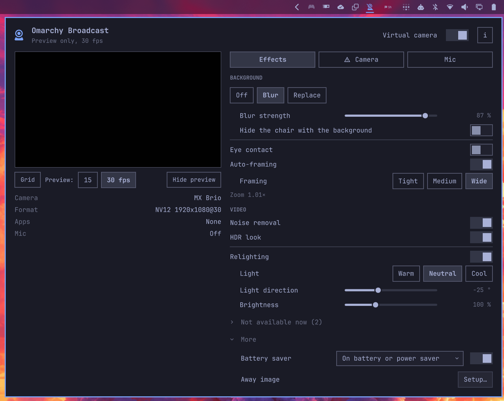
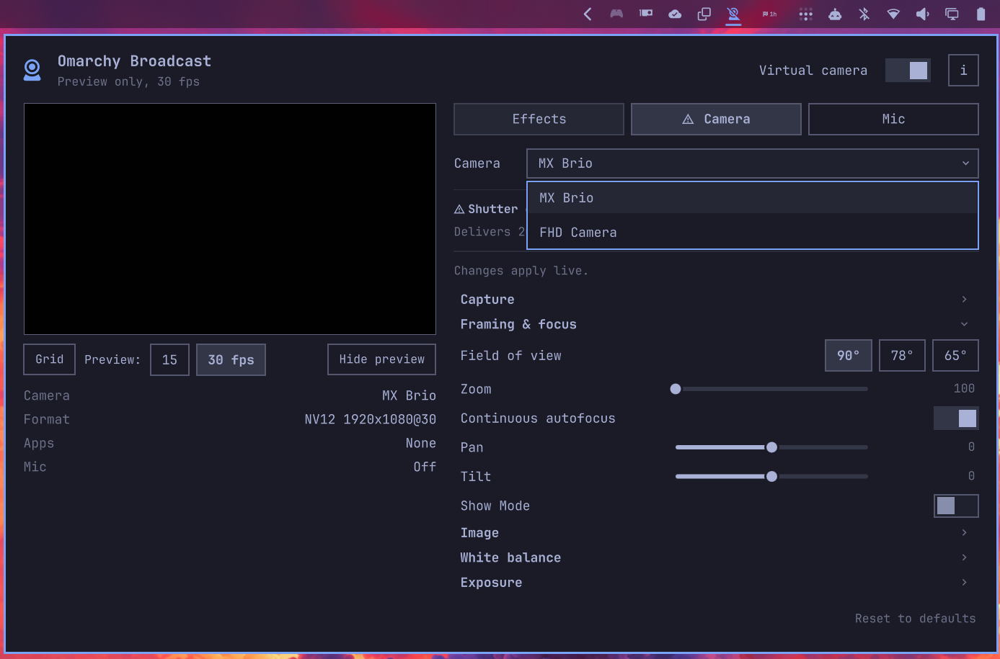
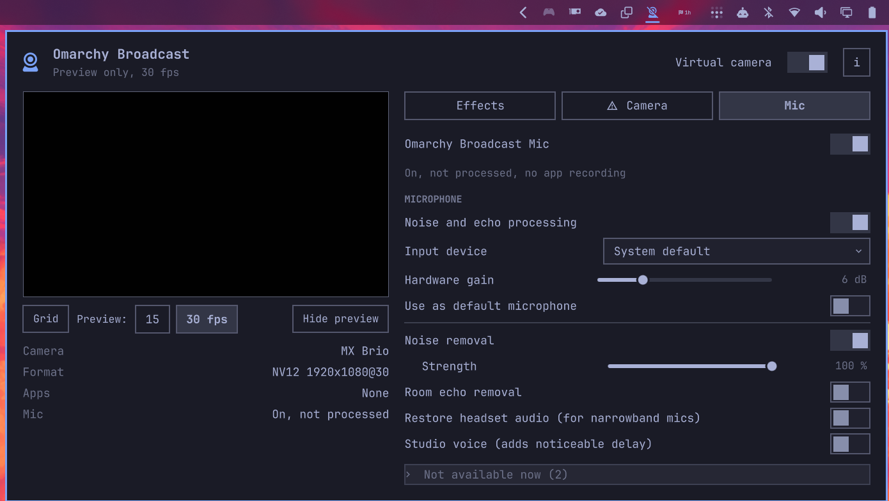
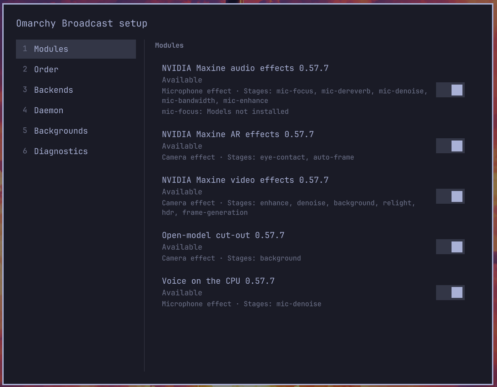

# Omarchy Broadcast bar plugin

**Live camera and microphone effects, one click from your Omarchy bar.** Blur or replace your background, clean up your microphone and tune your webcam from a panel on the bar.



This plugin is the control panel for [omarchy-broadcast](https://github.com/rsd/omarchy-broadcast), a daemon that turns your webcam into a virtual camera and your microphone into a virtual microphone, with effects applied on your machine. The daemon does the work. The plugin is the controls: an icon in the bar that shows the camera's state, a panel with the effects, the camera and the microphone, and a setup dialog. It is a client of the daemon and does not include it, so you install the daemon first.

## What you get

**Effects.** The Effects tab offers what the daemon's modules can do. The plugin names no effect: it draws what the daemon publishes, so a module you install appears with no plugin update.

On any machine (the CPU, or an Intel GPU or NPU, with the open ONNX models):

- Background blur, with its strength, and background replacement with a picture, an animated image or a video. Pick it from a gallery of bundled backgrounds and your own.
- Noise removal for the microphone.

With an NVIDIA RTX GPU, the optional NVIDIA Maxine modules add the same effects as the NVIDIA Broadcast app on Windows, built on the same NVIDIA Maxine SDKs:

- Background blur and replacement on the GPU.
- Video noise removal, which clears the grain of a webcam in a dim room.
- Relighting with a warm, neutral or cool light, with its direction and brightness.
- Enhancement of a camera that captures below the output size.
- Eye contact and auto-framing.
- Room echo removal and studio voice for the microphone.

**Camera.** Choose the camera and set its own controls: image, white balance, exposure, focus and zoom, whatever the camera offers. The tab shows the camera's health and applies the daemon's recommended settings with one click.

**Mic.** Turn the Omarchy Broadcast Mic on and off, choose its input device and adjust its processing. While an app records from it, a microphone glyph shows beside the bar icon.

<table>
  <tr>
    <td></td>
    <td></td>
  </tr>
  <tr>
    <td align="center">The Camera tab</td>
    <td align="center">The Mic tab</td>
  </tr>
</table>

**Details.** The (i) button shows live figures while the camera runs (frame rate, latency, CPU and GPU load), with a **Copy** button for bug reports.

## Why use it

- **Changes apply live.** Switch an effect or move a slider while the camera is in use, and video apps receive the change at once. Effect settings need no restart and no terminal.
- **One middle click turns the camera off.** The bar icon shows whether the camera is off, ready, starting or in use, and a middle click flips it.
- **The daemon runs locally, in any app.** Effects run on your machine. Chrome, OBS, Zoom and Discord select the virtual camera like any other camera.
- **The plugin is only the controls.** It needs no root, runs no package manager and no service manager. It never opens a camera device: it runs the `omarchy-broadcast` CLI as argument lists, never through a shell. It does not poll, and a hidden preview never starts the camera.

## Make it yours

A right click on the bar icon opens the setup dialog. Turn effect modules on or off, change the order their stages run in, choose the backend profile and which module provides each stage, edit the daemon's configuration, manage your backgrounds and away image, and read a diagnosis when something does not run.



The panel has a wide two-column layout and a narrow one-column layout. The preview is hidden by default, and the panel and the dialog work from the keyboard. Colours come from the active theme.

## Quick start

### Install

1. Install the omarchy-broadcast daemon and its CLI. On Omarchy they come from the AUR, with at least one effect module. [INSTALL.md](INSTALL.md#install-the-daemon) has the packages and links the daemon's full guide.
2. Install the plugin from the Omarchy plugin marketplace listing, or add it from its git URL and enable it on the bar:

   ```sh
   omarchy plugin add https://github.com/rsd/omarchy-broadcast-plugin
   omarchy plugin enable br.com.dias.omarchy-broadcast
   ```

3. Click the icon in the bar:

| Click | What it does |
|---|---|
| Left | Opens the panel: effects, camera, microphone and details |
| Middle | Turns the camera on or off |
| Right | Opens the setup dialog |

### Uninstall

To uninstall the plugin:

```sh
omarchy plugin disable br.com.dias.omarchy-broadcast
omarchy plugin remove br.com.dias.omarchy-broadcast
```

Removing the plugin does not touch the daemon. [INSTALL.md](INSTALL.md) has every step: the requirements, a local checkout, the `cliPath` setting, updating, the daemon's uninstall steps (linked) and troubleshooting.

## Learn more

- [INSTALL.md](INSTALL.md): the requirements, the install steps, updating, uninstalling and the connection messages.
- [LIMITATIONS.md](LIMITATIONS.md): what the plugin cannot do, and what to do about it.
- [docs/panel.md](docs/panel.md): the bar icon, the panel and its tabs, the keyboard, the plugin's settings, the live preview and the camera settings.
- [docs/setup-dialog.md](docs/setup-dialog.md): every section of the setup dialog.
- [docs/troubleshooting.md](docs/troubleshooting.md): the messages the panel shows while it works.
- [docs/development.md](docs/development.md): how the plugin talks to the daemon, the tests and versioning.
- The daemon: its [README](https://github.com/rsd/omarchy-broadcast#readme) and [INSTALL.md](https://github.com/rsd/omarchy-broadcast/blob/main/INSTALL.md).

## Notes for marketplace reviewers

The plugin runs only the `omarchy-broadcast` CLI and Omarchy's image picker and file chooser, plus two constant `sh -c` lookups on PATH. The rest run as argument lists. It runs no package manager and no service manager, and needs no root.
The external dependency, the commands it runs, the scan triggers and the test-only code are explained in [docs/development.md](docs/development.md#notes-for-maintainers-and-marketplace-review).

## Affiliation

The Omarchy Broadcast bar plugin is not affiliated with or endorsed by NVIDIA. NVIDIA, NVIDIA Broadcast and Maxine are trademarks of NVIDIA Corporation.

## Licence

Licensed under either of the [MIT License](LICENSE-MIT) or the [Apache License, Version 2.0](LICENSE-APACHE), at your option.
